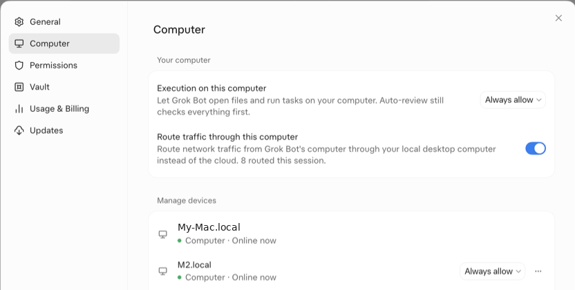
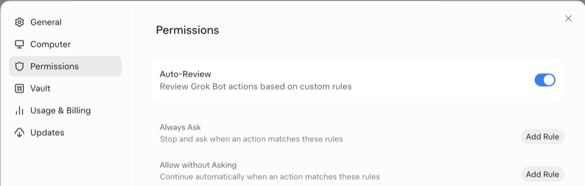
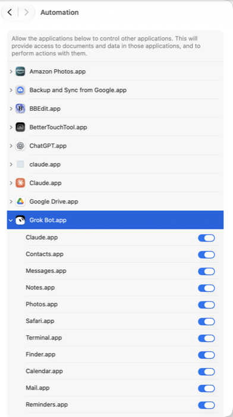
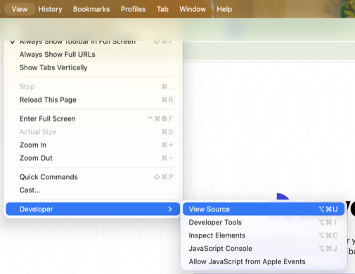

# fix-my-grokbot

**Your Grok Bot didn't get dumber. It lost its hands. Give them back.**

A 2-minute, read-only setup check that lets Grok Bot drive the apps on your Mac again (Mail, Messages, Calendar, Contacts, Reminders, Notes, and your browser) through `osascript`, macOS's built-in AppleScript runner.

> Unofficial and community-made. Not affiliated with SpaceXAI, xAI, or Grok.

---

## Symptoms

Sound familiar?

- "I can't read your Mac Mail."
- "I don't have access to your browser." / "I can't control Brave."
- "I can't send iMessages from here."
- "I can't see your calendar / reminders / notes."
- It asks *you* to copy-paste things it used to just do.

The model is fine. Usually it just **can't reach your apps** until you grant access and tell it which path to use. You fix that with Grok Bot running commands on your Mac (a machine-targeted shell) plus `osascript` talking to each app.

---

## Quick fix (one line)

Open **Terminal** on the Mac you want the bot to use and paste:

```bash
curl -fsSL https://raw.githubusercontent.com/txchai/fix-my-grokbot/main/fix-my-grokbot.sh | bash
```

Or download the script and run it:

```bash
bash fix-my-grokbot.sh            # full check
bash fix-my-grokbot.sh --no-open  # don't offer to open System Settings
bash fix-my-grokbot.sh --help
```

What it does:

1. Runs one harmless, **read-only** AppleScript per app, which makes macOS show its "allow control" prompt. Click **OK**.
2. Checks Brave, Chrome, and Safari (only if installed **and already open**): it counts tabs and tests page JavaScript.
3. Prints a **PASS / FAIL / SKIP** table and the exact fix for anything that failed.
4. Offers to open the Automation, Screen Recording, and Accessibility settings panes.
5. Prints the **bot instruction prompt** and copies it to your clipboard.

It never sends, deletes, or changes anything, and it prints **counts only** (e.g. "3 account(s)"), never names, addresses, or titles. Testing Mail, Messages, and the other apps may open them.

---

## Full manual guide

### 1. Install Grok Bot on the Mac and sign in

Once you're signed in, the Mac shows up in the Grok Bot app under **Settings → Computer → Manage devices**. Every Mac you add gets its own row there.

### 2. Let the bot run things on the Mac

Open Grok Bot **Settings** (`Cmd+,`), then go to **Computer**.



- **Execution on this computer** lets the bot open files and run tasks on this Mac. Set it to **Always allow**. Auto-Review still checks every action.
- **Manage devices:** each Mac has its own menu. Set **Always allow** on every Mac you want the bot to use, including a backup Mac.
- **Route traffic through this computer** (optional) sends the bot's web traffic through your Mac instead of the cloud. It helps with sites that block cloud computers.

### 3. Set your safety rules

Go to **Settings → Permissions**.



- Keep **Auto-Review** on.
- **Always Ask:** actions that must stop for your OK. For example:
  - `Send email to anyone outside my family`
  - `Submit any web form or payment`
- **Allow without Asking:** trusted repeat actions. For example:
  - `Read my Mac Mail inbox`
  - `Send iMessages to my partner`

### 4. Let Grok Bot control your Mac apps

Paste this in Terminal:

```bash
open "x-apple.systempreferences:com.apple.preference.security?Privacy_Automation"
```

Under **Grok Bot.app**, turn on each app you want it to drive (Mail, Messages, Calendar, Contacts, Reminders, Notes, Safari, Brave Browser, Google Chrome…).



An app appears in this list only after the first attempt to control it, which pops up an **"OK / Don't Allow"** box. Click **OK**. If you clicked "Don't Allow" earlier, flip the switch on here.

### 5. Optional: screenshots and keystrokes

Both are under **System Settings → Privacy & Security**. Add **Grok Bot**.

- **Screen Recording** lets the bot take screenshots:
  ```bash
  open "x-apple.systempreferences:com.apple.preference.security?Privacy_ScreenCapture"
  ```
- **Accessibility** lets the bot press keys and open menus:
  ```bash
  open "x-apple.systempreferences:com.apple.preference.security?Privacy_Accessibility"
  ```

### 6. Let the browser accept page scripts

Without this, the bot can list your tabs but can't read pages, fill fields, or click.

- **Brave / Chrome:** in the menu bar, choose **View → Developer → Allow JavaScript from Apple Events** and make sure it has a check mark.
- **Safari:** go to **Safari → Settings → Advanced** and turn on **Show features for web developers**. Then choose **Develop → Allow JavaScript from Apple Events**.



### 7. Test each app (copy-paste)

Each command should print something, not an error. The first run of each may show an **OK** prompt.

| App | Command |
|---|---|
| Mail | `osascript -e 'tell application "Mail" to count every account'` |
| Messages | `osascript -e 'tell application "Messages" to count every account'` |
| Calendar | `osascript -e 'tell application "Calendar" to count every calendar'` |
| Contacts | `osascript -e 'tell application "Contacts" to count every person'` |
| Reminders | `osascript -e 'tell application "Reminders" to count every list'` |
| Notes | `osascript -e 'tell application "Notes" to count every note'` |
| Brave tabs | `osascript -e 'tell application "Brave Browser" to count every tab of front window'` |
| Brave page JS | `osascript -e 'tell application "Brave Browser" to execute active tab of front window javascript "document.title"'` |
| Chrome page JS | `osascript -e 'tell application "Google Chrome" to execute active tab of front window javascript "document.title"'` |
| Safari page JS | `osascript -e 'tell application "Safari" to do JavaScript "document.title" in front document'` |

What the errors mean:

- `Not authorized to send Apple events … (-1743)`: Automation is off. Go back to step 4.
- `Executing JavaScript through AppleScript is turned off`, or Safari's "You must enable 'Allow JavaScript from Apple Events'": go back to step 6.

### 8. Tell the bot how to work

Paste this into your Grok Bot chat (the script also copies it to your clipboard):

```text
On my Mac, use osascript in a Shell command on that computer to drive my apps directly: Mail, Messages, Calendar, Contacts, Reminders, Notes, and my browser (list tabs and run page JavaScript to read pages, fill fields, and click). Read-only unless I ask for a change. Never read app databases directly. Always show me a preview before sending any message or email or submitting any form. If my main Mac is offline, use my other Mac. Try this before telling me something can't be done.
```

### 9. Keep the Mac awake

The Mac has to be on, logged in, and awake. For long tasks, run this and leave the window open:

```bash
caffeinate -d
```

---

## Safety

- **The checks are read-only.** The script only counts things. It never sends, deletes, moves, or edits anything, and it doesn't print personal data.
- **Preview before send.** The bot prompt above tells the bot to show you a preview before any message, email, or form submit. Pair it with **Always Ask** rules (step 3).
- **No database scraping.** The prompt tells the bot to use each app's official scripting interface and never read the apps' private database files.
- **Revoke anytime.** Go to System Settings → Privacy & Security → Automation and turn off any app under Grok Bot.app. You can also set "Execution on this computer" back to *Ask* in Grok Bot settings.
- **Read the script first.** It's one short bash file, so check it before piping anything to `bash`.

## Troubleshooting

| Problem | Fix |
|---|---|
| No OK prompt ever appears | The app was denied earlier. Turn it on in the Automation pane (step 4). As a last resort, reset all Automation choices with `tccutil reset AppleEvents`, then re-run. |
| Grok Bot.app isn't listed under Automation | Ask the bot to run one of the step 7 commands on your Mac. Its first attempt triggers the prompt. |
| Browser shows SKIP "not running" | Open the browser with a normal web page and re-run. The script never launches browsers. |
| Page JS fails but tabs pass | Turn on "Allow JavaScript from Apple Events" (step 6). It's set per browser and sometimes per profile. |
| Times out | A prompt may be hidden behind other windows, or the app is busy. Click OK and re-run. |
| Bot says the Mac is offline | Wake the Mac, make sure Grok Bot is running and signed in, and check that "Execution on this computer" isn't set to off. |
| Bot still says "I can't" | Paste the step 8 prompt again and ask it to try `osascript` on your Mac first. |
| Script says "only works on macOS" | Run it on the Mac itself, not in a cloud box or Linux machine. |

## Disclaimer

Unofficial and community-made. **Not affiliated with, endorsed by, or supported by SpaceXAI, xAI, or Grok.** "Grok" and related names belong to their owners. Use at your own risk; see [LICENSE](LICENSE).
